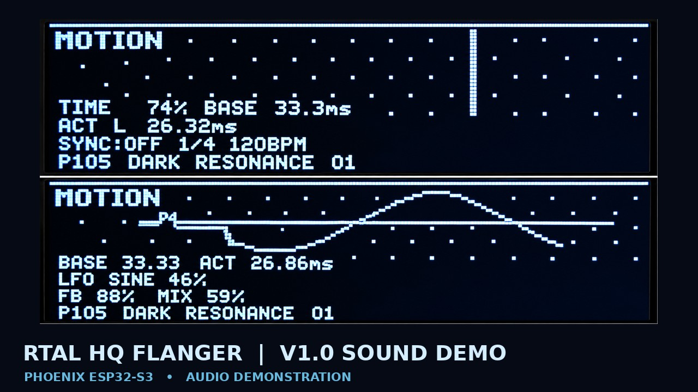

# RTAL-EAI-012-HQ-Digital-Flanger-Chorus
Stereo flanger and chorus with BBD-inspired sound parameters, LFO modulation with multiple waveforms and graphical visualization, 128 preset memory slots, preset browser with editable names, preset morphing with savable configurations, MIDI Control Change and MIDI Clock synchronization, OLED display and rotary encoder.

## 🎬 RTAL HQ FLANGER V1.0 – Sound Demo

Click the image to watch the RTAL HQ FLANGER V1.0 Sound Demo.
