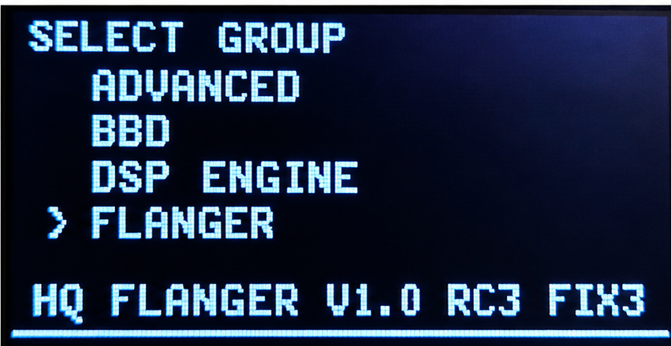
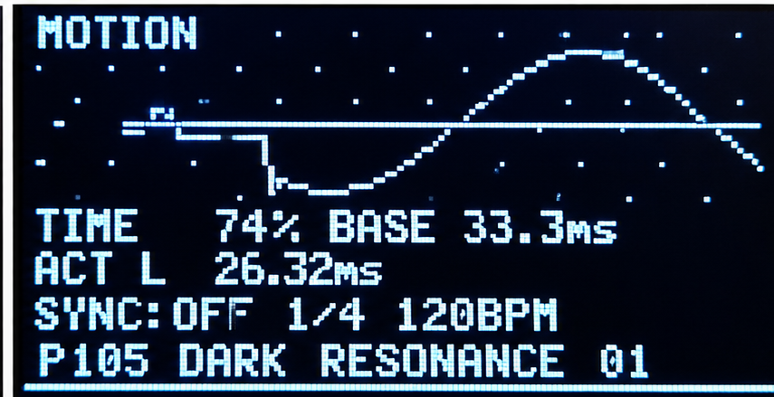
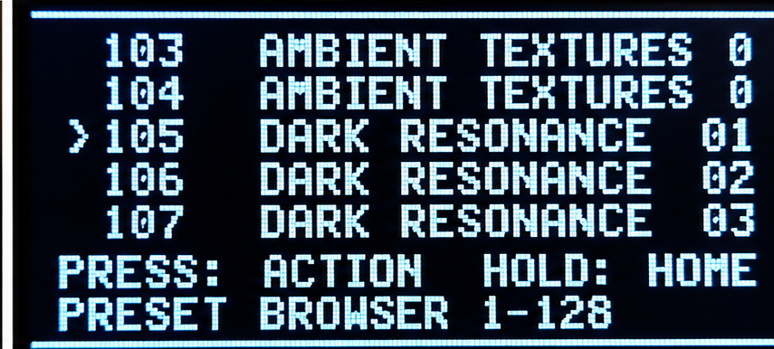
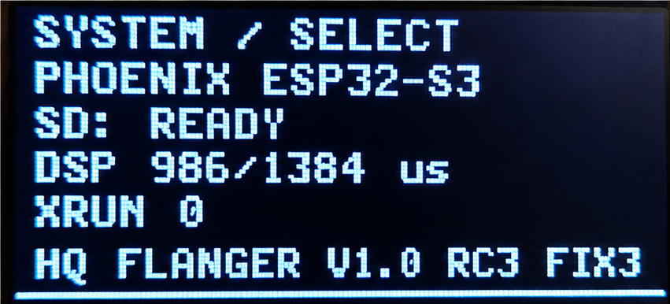

# RTAL-EAI-012 HQ FLANGER — Digital Stereo Flanger & Chorus

**Version 1.0 · Phoenix ESP32-S3 · 128 presets · Preset morphing · MIDI control**

RTAL HQ FLANGER is a hardware-based digital stereo flanger and chorus designed for the **ESP32-S3 platform**. It combines BBD-inspired sound shaping, flexible modulation, graphical feedback, preset management, and MIDI integration in a standalone effects processor.

> **Release status:** V1.0 Final Candidate 1 has been confirmed working on the target hardware. The V1.0 FINAL package is derived from that candidate with a version-label change; the separately renamed FINAL build should be compiled and checked before marking a GitHub release as fully verified.

## 🎬 RTAL HQ FLANGER V1.0 – Sound Demo

Hear and see the actual instrument.

Click the image to watch the RTAL HQ FLANGER V1.0 Sound Demo.

https://github.com/user-attachments/assets/7ec1192f-9a88-45e2-88b6-416ba4f6f3eb

---

## Highlights

- **Stereo flanger and chorus** with BBD-inspired tone and feedback controls.
- **Multiple LFO waveforms** and a real-time graphical motion display.
- **128 preset slots** (001–128), with a browser and editable preset names.
- **Preset morphing** between two sound configurations, with storable morph settings.
- **MIDI control:** Program Change, Control Change, and MIDI Clock synchronization.
- **Rotary encoder + OLED:** menu-based editing without requiring a computer.
- **SD-backed presets:** RAM preset caching and optimized save operations.
- **Embedded DSP:** 32 kHz audio processing on the Phoenix ESP32-S3 platform.

## Interface gallery

### Parameter groups

Navigate through the parameter groups to reach flanger, advanced, BBD, and DSP-engine settings.

### Motion display

The motion page provides visual feedback for modulation and delay-time behavior. The illustrated preset values are examples, not universal defaults.

### Preset browser

Browse slots **001–128**, select a sound, and access preset actions. Names and displayed values depend on the SD-card content.

### System and diagnostics

The system page reports hardware and SD-card status and can display DSP timing and underrun diagnostics. Diagnostic values are snapshots, not guaranteed benchmarks.

## Sound architecture

### Flanger and chorus

The instrument applies short modulated delays and feedback to create sweeping comb-filter effects, metallic flanging, and softer chorus textures. Its BBD-inspired controls are designed to shape the character of the effect; this is **digital DSP**, not an analog bucket-brigade circuit.

### Modulation

The modulation engine provides multiple LFO shapes and a graphical representation of the motion. Available parameters include delay time, modulation rate/depth, feedback, wet/dry mix, and additional engine-specific settings. For exact ranges and enumerated choices, consult the firmware and the matching manual.

### Preset morphing

Morphing blends between two selected preset states. Morph settings are saved with the relevant preset configuration. The firmware includes logic to avoid rewriting unchanged morph data and to maintain the preset cache after saves.

## Controls and workflow

1. Use the **rotary encoder** to browse menus and parameters.
2. Select the desired **parameter group** (for example, FLANGER, ADVANCED, BBD, or DSP ENGINE).
3. Edit the sound while monitoring the OLED display.
4. Open the **preset browser** to select a slot, rename a preset, or save changes.
5. Configure **morphing** to transition between two stored sounds.
6. Use MIDI Program Change or supported CC messages for external control.

> Encoder press/hold actions are context-sensitive. Refer to the firmware-matched user manual for the exact control sequence on each screen.

## Presets and SD storage

| Feature | Behavior |
| --- | --- |
| Preset range | 001–128 |
| MIDI Program Change | PC 0 → preset 001; PC 127 → preset 128 |
| Preset names | Editable on the device |
| Morph configuration | Stored with preset-related data |
| Persistent storage | SD card |
| Runtime optimization | RAM preset cache; selective morph saves |

**Back up your SD card before updating firmware or experimenting with preset files.** Keep the existing file layout and formats unless an official migration procedure is supplied. Do not remove the card while a save is in progress.

## MIDI implementation

| Capability | Description |
| --- | --- |
| MIDI transport | DIN MIDI on the Phoenix hardware |
| Program Change | 0–127 selects preset slots 001–128 |
| Control Change | Sound and morph parameters; bank-dependent mappings |
| Bank selection | CC 32 is used for parameter-bank selection |
| MIDI Clock | External synchronization for supported modulation functions |

**Important:** The complete CC assignment is firmware-version-specific. Use the dedicated **MIDI CC reference** matching your installed firmware. CC numbers may be reused across banks; transmit the appropriate CC 32 bank selection before sending bank-dependent controls. Avoid assuming that a CC number always addresses the same parameter.

## Hardware and technical overview

| Item | Specification / note |
| --- | --- |
| Platform | RTAL Phoenix, ESP32-S3 |
| Display | OLED |
| Main input control | Rotary encoder |
| Audio processing | Digital stereo effect, 32 kHz |
| Preset storage | SD card, 128 slots |
| External control | MIDI DIN; Program Change / CC / Clock |
| Firmware environment | Arduino IDE with the matching ESP32-S3 board support and Phoenix libraries |

Pin assignments, audio wiring, board options, and required library versions depend on the **specific Phoenix hardware revision**. Follow the pin definitions and build requirements in the included firmware package rather than substituting a generic ESP32-S3 wiring diagram.

## Build and installation

1. Download the firmware ZIP from the repository's **Releases** section (or use the checked-in firmware directory, if provided).
2. Extract the ZIP, preserving the Arduino sketch folder structure.
3. Open the `.ino` file in **Arduino IDE 2.x**.
4. Select the **ESP32-S3** board configuration used for your Phoenix hardware, including the correct flash/PSRAM settings.
5. Install the libraries required by that firmware revision; verify the display, SD, MIDI, and audio dependencies in the sketch.
6. Compile the sketch and resolve any missing dependencies before uploading.
7. Back up the SD card, upload the firmware, and restart the device.
8. Verify OLED startup, SD readiness, stereo audio, encoder operation, and preset loading.

**Do not overwrite a working installation solely to change the displayed version string.** The confirmed Final Candidate remains a useful fallback until the FINAL build has been independently tested.

## Suggested acceptance checks

- [ ] Boot succeeds with the SD card inserted.
- [ ] Stereo audio is clean in both flanger and chorus modes.
- [ ] Encoder navigation and all parameter groups work.
- [ ] Preset 001 (with morph) saves and reloads correctly.
- [ ] Preset 010 (without morph) saves and reloads correctly.
- [ ] Edited preset names survive a complete power cycle.
- [ ] Morph A/B selections and settings survive a complete power cycle.
- [ ] MIDI Program Change 0 and 127 select the first and last slots.
- [ ] Relevant MIDI CC banks and external clock operate as expected.
- [ ] No unexpected audio underruns occur during normal operation.

## Troubleshooting

| Symptom | What to check |
| --- | --- |
| SD card not ready | Card seating, filesystem, wiring, and Phoenix SD configuration |
| No audio | Input/output connections, mix/bypass settings, and audio hardware initialization |
| Preset changes disappear | Complete save operation, SD write access, and whether the correct slot was selected |
| MIDI CC changes the wrong setting | Current CC 32 bank and MIDI channel configuration |
| MIDI Clock has no effect | Sync mode, external clock source, and MIDI connection |
| Display looks incorrect | Correct Phoenix display driver, pins, and board build settings |
| Audio crackles | DSP load, underrun counters, and hardware audio configuration |

## Documentation

The release package may contain the following companion files:

- **User manual:** detailed operation, sound design, presets, and morphing.
- **MIDI CC reference:** controller numbers, parameter banks, and value interpretation.
- **Release notes:** changes and hardware verification status.
- **Firmware sketch:** the authoritative source for exact parameter ranges and hardware pin assignments.

The README deliberately avoids inventing unverified pin assignments, precise CC-to-parameter mappings, or DSP specifications not established by the supplied sources.

## Release history

| Milestone | Notes |
| --- | --- |
| RC3 FIX13F | Morph-index handling validated on hardware |
| RC3 FIX13G FIX1 | Direct RAM preset-cache refresh validated on hardware |
| V1.0 Final Candidate 1 | Confirmed operational on Phoenix hardware |
| V1.0 FINAL | Release package prepared; separately renamed firmware build awaits independent verification |

## Media and attribution

Photographs and screenshots document the RTAL HQ FLANGER hardware and interface. The sound demonstration uses a separate audio recording instead of the camera's original audio. Some enhanced promotional images may contain rendering artifacts; refer to actual firmware screens for authoritative labels and values.

## License and credits

GNU General Public License v3.

© 2026 RealTimeAudioLab · RTAL Embedded Audio Initiative

Acknowledgements: the pioneers of electronic music and classic phaser design; Espressif Systems and the Arduino/open-source audio community.

---

**RTAL HQ FLANGER — expressive digital flanging, chorus, modulation, and preset morphing on ESP32-S3.**
