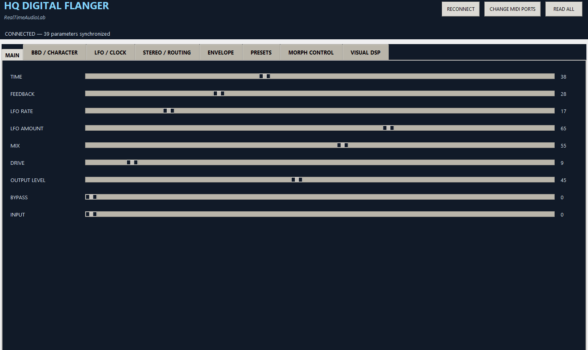
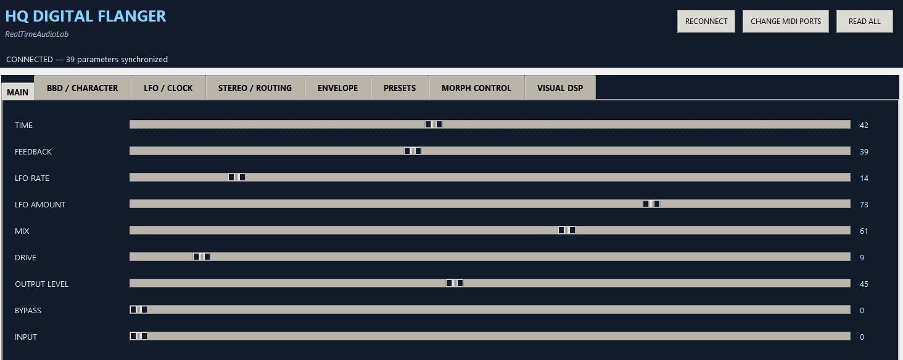
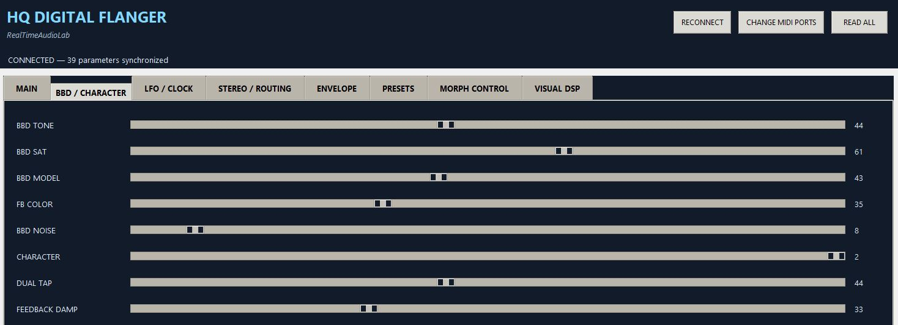
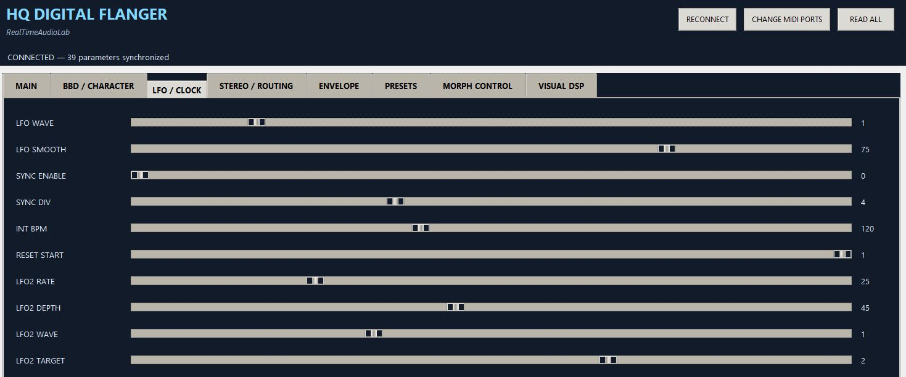
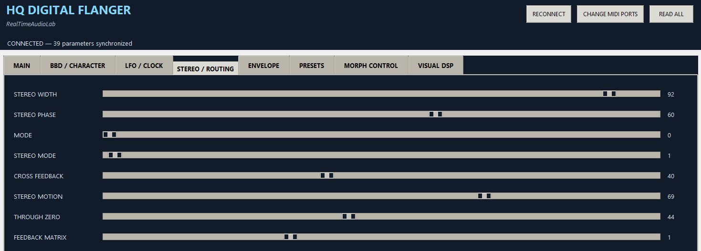
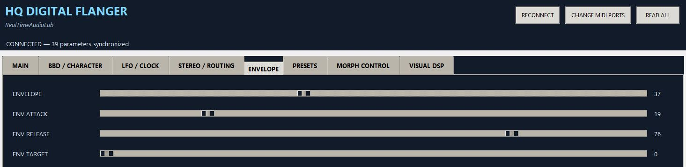
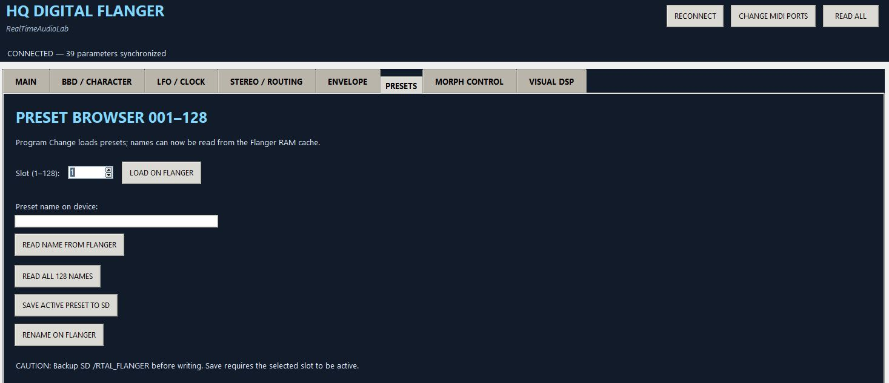
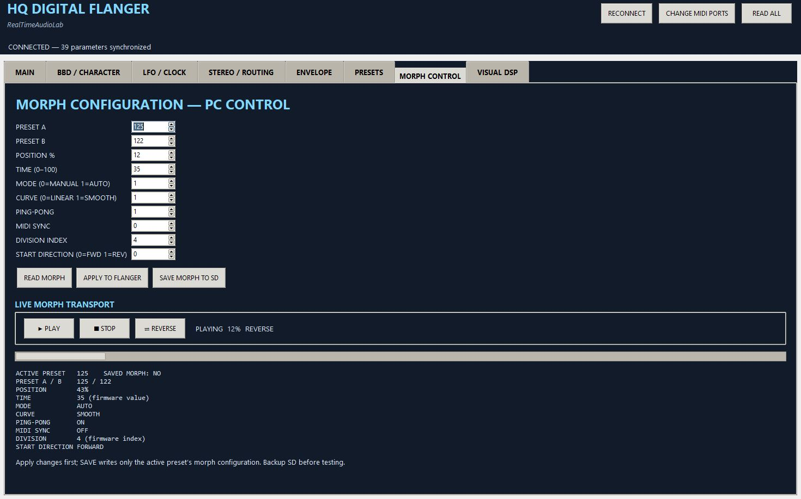
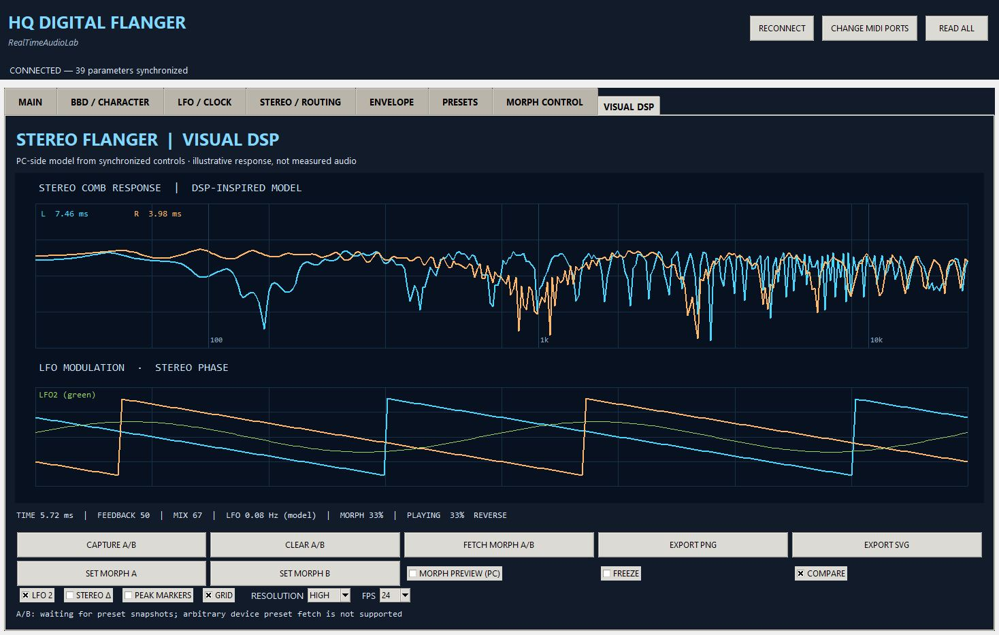

# RTAL HQ FLANGER — Windows Editor V1.0.0 FINAL

**RealTimeAudioLab · Graphical MIDI/SysEx editor · Windows 10/11 (64-bit)**

The **RTAL HQ FLANGER Editor** is the companion desktop application for the **RTAL HQ FLANGER** stereo flanger and chorus on the Phoenix ESP32-S3 platform. It provides direct control of **39 sound parameters**, bidirectional synchronization, access to **128 presets**, morph configuration and transport, and a PC-side **VISUAL DSP** display.

> **Compatibility:** Developed and hardware-tested with the **C2 FIX7** firmware base, released as **RTAL HQ FLANGER V2.0.0 FINAL**. The editor's footer may display **“Firmware 1.0.0”** as a UI label; this does not change the actual installed firmware version. The separately repackaged V2.0.0 FINAL firmware should be compiled and checked on the target hardware.

## Editor in action



*Animated editor preview (if the uploaded GIF contains multiple frames).*

## Features

- **Live MIDI/SysEx editing:** change sound parameters from Windows and synchronize them with the hardware.
- **39 synchronized parameters** organized into clear functional pages.
- **MIDI connection management:** select MIDI IN/OUT ports, reconnect and restore previously working ports automatically.
- **128 preset slots (001–128):** load presets, read names, rename and save the active preset to SD.
- **Morph Control:** select A/B presets, edit position and timing, choose linear/smooth behavior, configure ping-pong, sync and direction, and use PLAY / STOP / REVERSE.
- **Background Preset Read:** fetch stored A/B preset snapshots for visualization without activating them or interrupting the currently sounding preset.
- **VISUAL DSP:** illustrative stereo comb-filter response, LFO modulation display, A/B comparison, freeze and PNG/SVG export.
- **Standalone Windows EXE:** build locally with the included Python 3.12 / PyInstaller script.

## Screenshots and interface guide

### MAIN — primary flanger controls



Adjust **TIME**, **FEEDBACK**, **LFO RATE**, **LFO AMOUNT**, **MIX**, **DRIVE**, **OUTPUT LEVEL**, **BYPASS** and **INPUT**. The editor displays the current parameter values and synchronizes changes with the device.

### BBD / CHARACTER — tone and feedback shaping



Shape the BBD-inspired digital character with controls such as **BBD TONE**, **BBD SAT**, **BBD MODEL**, **FB COLOR**, **BBD NOISE**, **CHARACTER**, **DUAL TAP** and **FEEDBACK DAMP**.

### LFO / CLOCK — modulation and timing



Configure LFO waveforms, smoothing, internal tempo, MIDI synchronization, clock division and the secondary LFO's rate, depth, waveform and destination.

### STEREO / ROUTING — stereo image and signal flow



Control **STEREO WIDTH**, **STEREO PHASE**, routing modes, **CROSS FEEDBACK**, **STEREO MOTION**, **THROUGH ZERO** and the **FEEDBACK MATRIX**.

### ENVELOPE — dynamic modulation



Adjust the envelope amount, attack, release and modulation target.

### PRESETS — 128-slot browser



Use **LOAD ON FLANGER** to activate a selected slot. Read one name or all 128 names, rename a preset, and save the **active** preset to SD. **Back up the SD card before writing.** MIDI Program Change values **0–127** correspond to preset slots **001–128**.

### MORPH CONTROL — preset transitions



Set **PRESET A/B**, position, morph time, MANUAL/AUTO mode, LINEAR/SMOOTH curve, PING-PONG, MIDI sync, division and start direction. Use **READ MORPH**, **APPLY TO FLANGER**, and **SAVE MORPH TO SD** to manage the configuration. The live transport offers **PLAY**, **STOP** and **REVERSE**.

> **Save behavior:** Apply the intended changes before saving. Morph saving affects the active preset's morph configuration; back up SD data first.

### VISUAL DSP — PC-side analysis and preview



The **VISUAL DSP** page models the stereo comb response and modulation behavior based on synchronized control values. It supports **CAPTURE A/B**, **CLEAR A/B**, **FETCH MORPH A/B**, **SET MORPH A/B**, **MORPH PREVIEW (PC)**, **FREEZE**, **COMPARE**, display options and **EXPORT PNG / EXPORT SVG**.

**Important:** VISUAL DSP is an *illustrative mathematical model*, **not** a measured audio-frequency response or an audio stream from the hardware. Its calculations run on the PC rather than in the ESP32-S3 audio task.

## Quick start

1. Connect the RTAL HQ FLANGER to the computer through a compatible MIDI interface with **both MIDI directions** available.
2. Start `RTAL_HQ_FLANGER_EDITOR.exe` or run the Python source.
3. Select the correct **MIDI IN** and **MIDI OUT** ports if they are not restored automatically.
4. Click **RECONNECT** if necessary, then **READ ALL** to retrieve the device parameters.
5. Confirm the connection status indicates that the **39 parameters** are synchronized.
6. Edit sounds, browse presets or open **VISUAL DSP**.

### Read morph endpoints without changing the sound

1. Leave the currently playing preset active on the hardware (for example, **050**).
2. On **MORPH CONTROL**, choose the desired A/B preset slots (for example, **001** and **105**).
3. Open **VISUAL DSP** and click **FETCH MORPH A/B**.
4. The editor retrieves the stored parameter snapshots from the firmware's RAM preset cache **without issuing a preset change**.
5. Enable **MORPH PREVIEW (PC)** to inspect the modeled transition. The fetched snapshots are kept in the current editor session.

## Windows installation

### Option A — use a prebuilt EXE

If the GitHub release includes a verified Windows executable, extract the release archive and start `RTAL_HQ_FLANGER_EDITOR.exe`. A prebuilt EXE is **not guaranteed** to be present in the source archive.

### Option B — build the EXE from source

**Requirements:** Windows 10/11 (64-bit), **Python 3.12 (64-bit)** with the `py` launcher, and an internet connection to install Python dependencies.

1. Download or clone the editor source directory.
2. Double-click **`BUILD_WINDOWS_EXE.cmd`**.
3. The script creates `.venv312`, installs `mido`, `python-rtmidi` and PyInstaller, then packages the editor.
4. After a successful build, find the executable at **`dist\RTAL_HQ_FLANGER_EDITOR.exe`**.

The build script explicitly selects Python **3.12** to avoid the `python-rtmidi` source-build failure observed with Python 3.15. Python 3.15 does **not** need to be uninstalled.

### Run directly from source

```bat
py -3.12 -m pip install -r requirements.txt
py -3.12 flanger_graphical_editor.py
```

## Repository files

| File | Purpose |
| --- | --- |
| `flanger_graphical_editor.py` | Graphical editor, MIDI communication and user interface |
| `visual_dsp_model.py` | PC-side visual DSP model |
| `requirements.txt` | Python dependencies (`mido`, `python-rtmidi`) |
| `BUILD_WINDOWS_EXE.cmd` | Reproducible Python 3.12 Windows EXE build |
| `START_EDITOR.bat` | Convenience launcher for the Python editor |
| `CHANGELOG.md` | Editor development history |
| `RELEASE_NOTES.md` | Release notes |
| `TEST_CHECKLIST.md` | Suggested functional and regression tests |

## Troubleshooting

| Symptom | What to check |
| --- | --- |
| No MIDI connection | Correct IN/OUT ports, MIDI interface, cable routing and device power; try **RECONNECT** |
| Parameters are not synchronized | Click **READ ALL** after establishing both MIDI directions |
| A preset change is not audible | Check active slot, hardware bypass/mix and whether **LOAD ON FLANGER** was used |
| Preset save or rename fails | Confirm the intended active preset and SD-card write access; back up first |
| Morph preview lacks A/B data | Select A/B slots and use **FETCH MORPH A/B** with compatible C2 FIX7 firmware |
| `python-rtmidi` build fails | Build using **Python 3.12**, not the default Python 3.15 interpreter |
| EXE does not start | Rebuild with `BUILD_WINDOWS_EXE.cmd` and check any displayed build errors |

## Compatibility and release status

| Component | Version / requirement |
| --- | --- |
| Windows editor | **V1.0.0 FINAL** |
| Compatible firmware base | **V2.0.0 C2 FIX7** (background preset read protocol) |
| Firmware release | **RTAL HQ FLANGER V2.0.0 FINAL** (based on C2 FIX7) |
| Hardware | RTAL Phoenix ESP32-S3 |
| Windows | 10 / 11, 64-bit |
| Python build environment | 3.12, 64-bit |
| Presets | 128 slots |
| Synchronized sound parameters | 39 |

The C2 FIX7 background-preset-read function and the Python 3.12 Windows build procedure have been successfully exercised during development. This README does not claim a separate full regression test of every feature on an independent Windows installation.

## Documentation and credits

For the complete instrument overview, hardware installation and MIDI CC assignments, see the **[main project README](../README.md)** and the firmware-matched documentation. For the detailed editor walkthrough, consult the **RTAL HQ FLANGER Editor V1.0.0 FINAL User Manual**, if included in the repository or release assets.

**RealTimeAudioLab · © 2026**

*RTAL HQ FLANGER — expressive stereo modulation with hands-on hardware control and a visual Windows editor.*
